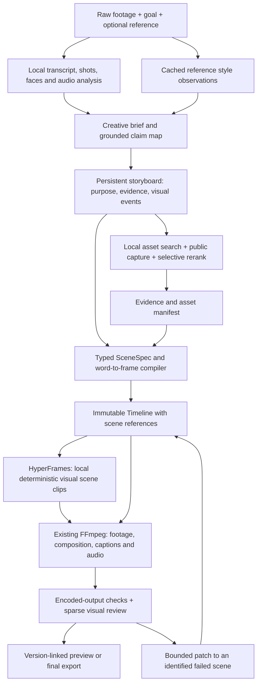

# Phase 7c: Hybrid architecture for reference-quality visual explainers

Status: implementation and real-media demonstration present (2026-10-31). The
storyboard/scene pipeline, seven visual families, image-bearing critic, guarded
revisions, durable worker flow and Studio controls are implemented. A 60-second
public livestream excerpt was edited to a reviewed 53.08-second vertical export.
Full phase acceptance is **not complete**: historical golden reconciliation and
the three-source randomized human benchmark remain open. See section 12 for the
measured implementation record and exact limits. Earlier research is a source
inspection record, not a claim that all proposed rollout gates have passed.

## 1. Recommendation and intended product

Keep ClipZ's Python API, provider contracts, word-anchored Timeline, immutable
versions, licensed asset catalog, Arq jobs and deterministic FFmpeg compositor.
Add a persistent storyboard and a typed scene compiler. Use **HyperFrames as the
first scene-rendering backend**, behind a small adapter, for reviewed HTML/SVG
motion components with changing states. FFmpeg remains responsible for original
footage, captions, audio and the final master.

Borrow architectural patterns selectively:

- **browser-use/video-use:** compact transcript context, on-demand visual inspection
  and review of the actual rendered output around editorial decisions.
- **HyperFrames:** deterministic seeking, readiness barriers, reusable visual
  components and the same scene runtime for preview and scene rendering.
- **Motion Canvas:** named animation cues and explicit sequencing of visual events.
  Adopt the idea in our scene contract; do not add a second animation runtime.
- **OpenChatCut:** editable motion assets and a shared project document for human
  and agent edits. Its preview/export caveats are also useful failure cases.
- **MakeMyClip:** revision-aware writes, a composition document, operation history
  and read-only project inspection. Keep ClipZ's existing snapshot history rather
  than replacing it with the upstream operation-log implementation.
- **VEED Open Edit:** virtual-clock rendering, selective re-rendering, transcript
  retiming and separation of visual rendering from audio assembly.

The proposed positioning is: **turn a spoken technical explanation into a
source-backed visual demonstration, with editable diagrams and events synchronized
to the narration.** Quality comes from showing relationships, evidence and results
at the right moment. Cost control supports that outcome. Market exclusivity and a
quality advantage are hypotheses to validate, not established claims.

Initial audience: developers, educators and founders making technical explainers,
product walkthroughs and project showcases. Preserve ordinary talking-head editing;
do not turn this phase into a general-purpose desktop NLE or a faceless-video factory.

## 2. Evidence from the current implementation

The inspected reference progresses from a promise and repository evidence to
product examples, architecture, verification states, reports and a practical action.
Its 36–48s sequence is particularly instructive: architecture -> candidate findings
-> changed verification states -> a report. Our corrected test uses nine authored
shots and five image assets, dominated by repeated documents and one static diagram.

Current architecture gaps, verified in this checkout:

1. `app/tools/mvp.py::PlanEditIn` contains a summary, steps and word/show moments.
   `app/tools/executor.py::_plan_edit` validates anchors and returns warnings. It
   does not persist a storyboard, visual purpose, evidence needs or changing states.
2. `app/showcase/images.py` rasterizes fixed cards. `Overlay.motion` moves the whole
   image. Nodes, connectors, counters and result states cannot evolve independently.
3. `app/providers/local.py` ranks catalog items with tags, titles and synonyms.
   `app/inserts/keywords.py` finds named-entity cues. This is useful for logos, but
   insufficient for choosing proof, a mechanism demonstration or an outcome shot.
4. `app/agent/critic.py::evaluate_preview` extracts JPEGs but sends only their
   timestamps in text. `ChatMessage.content` in `app/providers/base.py` is a string;
   the current completion adapter does not attach those image bytes. The Director
   currently invokes the critic without a rendered video path anyway.
5. The heuristic critic rewards counts and configuration presence: two visual
   elements can earn a high visual score; music or an audio effect can earn a high
   audio score. Neither establishes visual quality or a good mix.
6. Production render requests are asynchronous (`app/services/renders.py` and
   `app/workers/render.py`). A genuine render-review-repair loop needs durable job
   orchestration rather than a critique of EDL intentions inside one chat turn.
7. The missed README leak demonstrated why successful decode and a few spot checks
   are insufficient. Split-panel chaining now stops around proof shots, with unit
   and mixed-layout golden coverage; the broader scene/layer ownership model is absent.
8. `app/style/learn.py` learns preferences from accepted ClipZ timelines. It does
   not analyze an arbitrary reference video's visual grammar.

Known baseline: 440 unit/offline eval tests and five targeted proof/interruption
tests passed after the overlap fix. Seven historical golden mismatches remain
unresolved. Studio infrastructure was degraded after the local disk/Docker failure.
These are existing gaps to reconcile, not completed production acceptance.

## 3. GitHub research and critical selection

Twelve valid repositories were screened using GitHub metadata, repository files
and official documentation. Stars below are a snapshot from 2026-10-31, not a
ranking of video quality. Maintenance dates and source limitations matter more.
The research manifest records inspected files, blob hashes and available commit refs.

### Primary runtime: heygen-com/hyperframes — 76,407 stars, Apache-2.0

Its deterministic rendering documentation specifies an integer frame clock,
seekable animation timelines, assets loaded before capture, and fixed dimensions.
The frame-adapter contract separates initialization, seeking and teardown.
The repository has late-image and capture-failure tests. This fits our need for
polished diagrams and UI scenes without model inference for every frame.

Use it for **scene pixels only** in the first integration. ClipZ owns scene data,
timing, permissions, source audio and export. Compile reviewed components from typed
parameters; do not adopt arbitrary agent-generated HTML/JavaScript as executable input.

Critic findings: the capture source exposes `renderReadyTimedOut` and documents a
path that proceeds after readiness timeout. Our adapter must treat this as a failed
scene, not a usable export. Its HTML schema also distinguishes media offsets and
display tracks: a track index does not itself prevent overlap. We must retain our
own schedule and occupancy validation. Browser, font and hardware differences still
require pinned render environments and actual-output checks.

Sources: [determinism](https://github.com/heygen-com/hyperframes/blob/a04b45a6db0d1f724be9cf1985c3b13657195f0d/docs/concepts/determinism.mdx),
[frame contract](https://github.com/heygen-com/hyperframes/blob/a04b45a6db0d1f724be9cf1985c3b13657195f0d/docs/concepts/frame-adapters.mdx),
[capture source](https://github.com/heygen-com/hyperframes/blob/a04b45a6db0d1f724be9cf1985c3b13657195f0d/packages/cli/src/capture/captureCompositionFrame.ts),
[HTML schema](https://github.com/heygen-com/hyperframes/blob/a04b45a6db0d1f724be9cf1985c3b13657195f0d/docs/reference/html-schema.mdx).

### Inspection pattern: browser-use/video-use — 30,266 stars, MIT

Adopt transcript-first reasoning, cached phrase summaries, on-demand filmstrip /
waveform inspection and review at relevant cut boundaries. Its renderer assembles
real footage, overlays and subtitles; it is useful precedent for our existing core.
It is an agent skill and helper scripts, not a complete multi-user editing backend.
Its raw grading-filter escape hatch conflicts with ClipZ's typed-renderer rule;
retain our bounded models and provider abstraction. Its rendering/self-evaluation
claims have not been independently benchmarked in this research.

Sources: [README](https://github.com/browser-use/video-use/blob/43cfc566833548093455c9d4a46bd69913b7e552/README.md),
[timeline inspector](https://github.com/browser-use/video-use/blob/43cfc566833548093455c9d4a46bd69913b7e552/helpers/timeline_view.py),
[renderer](https://github.com/browser-use/video-use/blob/43cfc566833548093455c9d4a46bd69913b7e552/helpers/render.py).

### Cue design: motion-canvas/motion-canvas — 19,614 stars, MIT

Its generator-based animation model and named time events are useful for staging
relationships and synchronizing reveals. Reimplement the cue concept as word/beat
anchors resolved by ClipZ. Running Motion Canvas alongside HyperFrames is unnecessary
for the first release. Source-time event offsets are not a replacement for our
word-based EDL. Last recorded push: 2026-07-02.

Sources: [project](https://github.com/motion-canvas/motion-canvas),
[time event interface](https://github.com/motion-canvas/motion-canvas/blob/7b91435c301d530351dcf5ebb91dd139c002e405/packages/core/src/scenes/timeEvents/TimeEvents.ts).

### Editable project pattern: 0xsline/OpenChatCut — 2,816 stars, AGPL-3.0

Its README describes persistent editable projects, motion assets, agents and a
timeline. Borrow the product requirement that an animation remains editable after
generation. Its motion-graphics pipeline rules document cases where browser preview
looks correct but local export becomes black, including SVG/compositor interactions.
That is evidence for actual export verification, not a reason to share its renderer.

Use architectural ideas rather than copying its code into ClipZ in this plan.
Any future code reuse needs a deliberate license compatibility decision. Its broad
desktop/editor/provider surface is much larger than the reference-quality problem.

Sources: [README](https://github.com/0xsline/OpenChatCut/blob/7fa4b7903e7ebecf832a36249f0c0c755200cc17/README.md),
[preview/export caveats](https://github.com/0xsline/OpenChatCut/blob/7fa4b7903e7ebecf832a36249f0c0c755200cc17/src/agent/skills/create-motion-graphics/references/canvas-pipeline-rules.md),
[license](https://github.com/0xsline/OpenChatCut/blob/7fa4b7903e7ebecf832a36249f0c0c755200cc17/LICENSE).

### Mutation pattern: MakeMyClip/editor — 5 stars, MIT

This is a small, early project, included for source-level patterns rather than
popularity. Its document store supports revision-aware writes and its composition
model separates document data from export compilation. However, its current
compiler explicitly rejects multiple populated video tracks, separate audio tracks
and other compositing cases. Its multitrack schema is not proof of equivalent
multitrack export support. Retain ClipZ's existing compositor and snapshots.

Sources: [document store](https://github.com/MakeMyClip/editor/blob/782059842d3b2d3b15be55d5ec47035c1f4cbec5/src/timeline/document-store.ts),
[compiler limits](https://github.com/MakeMyClip/editor/blob/782059842d3b2d3b15be55d5ec47035c1f4cbec5/src/timeline/compile.ts).

### Render orchestration pattern: veedstudio/open-edit — 1,756 stars, Apache-2.0

Its local renderer uses a virtual clock and its CLI documents selective rendering,
transcript retiming and separate audio assembly. Adapt these boundaries, while
keeping our current workers and mixer. Hosted generation, login and billing services
are not needed for the proposed hybrid. Local rendering is not the same as its
optional paid media services.

Sources: [CLI surface](https://github.com/veedstudio/open-edit/blob/1d3b75b7f46280061bae5ab4cb47b9538276d8fb/README.md),
[virtual clock](https://github.com/veedstudio/open-edit/blob/1d3b75b7f46280061bae5ab4cb47b9538276d8fb/cli/src/render/page-runtime.ts).

### Evaluated alternatives and why they are not the base

- **remotion-dev/remotion — 69,340 stars, Remotion License.** Strong alternative
  for schema-validated parameterized React scenes and server rendering. Keep it as
  the fallback candidate for the engine spike, not an additional mandatory runtime.
  Eligibility/company-license terms must be checked for the actual organization;
  source availability does not imply unrestricted MIT use.
  [Props](https://www.remotion.dev/docs/parameterized-rendering),
  [rendering](https://www.remotion.dev/docs/renderer/render-media),
  [license](https://github.com/remotion-dev/remotion/blob/main/LICENSE.md).
- **OpenCut-app/OpenCut — 96,937 stars, MIT.** Current README says the architecture
  is being designed around a Rust core. The inspected desktop preview panel renders
  a placeholder labelled Preview. This observation concerns that current branch
  and panel, not every historical release. A rewrite is a poor core dependency for
  closing our immediate scene-quality gap.
  [README](https://github.com/OpenCut-app/OpenCut/blob/e668010778568641babef2cc40be4703ae6916d6/README.md),
  [preview panel](https://github.com/OpenCut-app/OpenCut/blob/e668010778568641babef2cc40be4703ae6916d6/apps/desktop/src/panels/preview.rs).
- **gyoridavid/short-video-maker — 1,452 stars, MIT.** A useful scene-input and
  dependency separation example, but oriented toward stock footage, generated
  narration and captions. The inspected queue contains mutex/semaphore TODOs; last
  recorded push is 2025-06-21. Keep Arq and original narration.
  [creator](https://github.com/gyoridavid/short-video-maker/blob/9bb9a212ced86caa7e09099c382da1a44d638760/src/short-creator/ShortCreator.ts).
- **harry0703/MoneyPrinterTurbo — 136,808 stars, MIT.** Broad script/material/TTS
  automation and provider orchestration are worth studying. That workflow does not
  by itself establish technical-diagram or real-footage editing quality. Avoid
  importing its provider breadth and generic stock-selection assumptions.
  [project](https://github.com/harry0703/MoneyPrinterTurbo),
  [task source](https://github.com/harry0703/MoneyPrinterTurbo/blob/main/app/services/task.py).
- **ManimCommunity/manim — 42,059 stars, MIT.** Excellent optional specialty for
  precise mathematical explanations. It is unnecessary as a second default runtime
  for product screens and UI-style diagrams. Defer until a real math use case.
  [project](https://github.com/ManimCommunity/manim).
- **diffusionstudio/core — 1,252 stars, MPL-2.0 metadata.** Browser composition,
  keyframes and WebCodecs are useful patterns, but its README describes watermark /
  commercial-key terms and says server-side rendering and HTML/React composition
  are poor fits. These terms and deployment differences need separate evaluation;
  do not treat its metadata license alone as the complete product terms.
  [README](https://github.com/diffusionstudio/core/blob/4e784a7136b3b08e7b9b0c69504085897bf18647/README.md).

The attempted Revideo repository addresses returned unavailable/not-found responses.
No Revideo implementation claim or dependency decision is based on those addresses.

## 4. Target architecture

This is one application with staged jobs, not a new service per box. An animation
runtime still rasterizes video frames locally. The excluded expense is AI inference
or generative editing for every frame; rendering frames does not require such calls.

### Data contracts

Add strict, versioned models under `app/storyboard/` and `app/scenes/`:

- `ReferenceStyleRecipe`: observed layouts, typography, motion families, visual
  roles, reading holds and example frame references. Distinguish measured values,
  model interpretation and user choices; record confidence. It contains style
  observations, not permission to reuse the reference's claims or assets.
- `CreativeBrief`: audience, single promise, intended takeaway, permitted editorial
  changes, source limitations, aspect/FPS and cost budget.
- `Claim`: transcript word range, entity, assertion, caveat and evidence references.
  Documentation can support an explanation; it must not be presented as a real
  execution result. Preserve uncertainty and corrections in the original speech.
- `StoryboardBeat`: stable ID, start/end word or beat anchors, narrative role
  (`promise`, `evidence`, `demonstration`, `mechanism`, `result`, `transition`),
  visual family, desired viewer understanding, evidence IDs and unresolved needs.
- `SceneSpec`: template ID/version, named nodes and edges or typed UI fields,
  local asset references, cue events, camera preset, design tokens and protected
  areas. The schema is a discriminated union per template, not an unbounded dict.
- `VisualEvent`: reveal/highlight/connect/update/focus/hide targeting an existing
  element and anchored to a real word. Durations come from bounded motion presets;
  the compiler derives frame numbers. No invented absolute source timestamps.
- `EvidenceAsset`: source URL/file, capture date, SHA, source crop/clip ID, local
  dimensions, allowed uses, attribution and whether it is observed or illustrative.
- `ScenePlacement`: scene spec hash plus word anchors, slot and layer ownership.
  `SceneArtifact`: output hash, dimensions, FPS, frame count and template/runtime refs.
- `QualityAssessment`: exact render/version hashes, checks executed, frames/audio
  actually reviewed, findings, evidence locations and bounded repair suggestions.
  Unavailable creative review is a distinct state, never a professional-quality pass.

Persist storyboard revisions as immutable project artifacts; embed their hash and
scene references in Timeline snapshots. Existing snapshots default to no storyboard
and no scenes. Rebuild artifacts from specs; retain user-editable parameters after export.

### Timing, layers and compatibility

Structural speech edits happen before visual planning. Cache the storyboard against
the transcript and retained-clip map. A later trim/reorder invalidates affected anchors;
recompile or request a replacement anchor instead of silently shifting the meaning.
Build a single `TimingMap` from source words through edited output to frame intervals.
Use half-open intervals `[start_frame, end_frame)` and explicit slots/layer priorities.
Insertion order must not determine visual ownership. A full-page scene suppresses
the previous split panel; captions occupy their own protected layer after visuals.

Keep 30 FPS as the first supported scene profile. Current output schema permits other
rates while several renderer paths use 30; either restrict the new path explicitly
or parameterize every frame calculation before advertising other rates.

Retain legacy overlay tools. Compile scene placements into a common render schedule
alongside overlays. Old insert density restrictions remain for decorative overlays;
storyboard scenes may be consecutive when the narrative calls for them. This is a
proposed extension to BLUEPRINT section 3's short-insert assumptions, to be recorded
as an implementation ADR when the schema lands.

### Rendering and caching

`SceneRenderer` accepts only a validated spec, resolved local assets and a render
profile. It returns a silent scene clip and manifest. Start with opaque visual panels
or full-page scenes; avoid alpha codec compatibility until a real case needs it.
Use the existing FFmpeg mixer once, preventing duplicate narration or music mixes.

Cache keys include spec schema/version, template source version, asset bytes, font
checksums, runtime/browser version, resolution, FPS and compiled cue frames. Preview
and final use the same design and scene runtime at different output profiles.
Dependencies load locally before frame zero. Fail on missing fonts, late resources,
ready timeout, scene exceptions, wrong frame counts or a blank required scene.
Final rendering has no network access and accepts no source-supplied executable code.

## 5. Asset and B-roll strategy

Resolve a visual's purpose before searching for media. Priority: user's footage and
screen recordings -> exact official/product evidence -> relevant licensed library
material -> labelled code-native illustrations. Use generated imagery only for a
specific missing asset with an explicit budget; it is not the default pipeline.

Keep tag search as the cheap first stage. Add entity/URL matching, deduplication,
text/OCR relevance, aspect/resolution checks and local image embeddings when needed.
Batch vision reranking over a small shortlist; a screenshot's readable focal region
matters more than generic visual similarity. Cache candidates and rejections.

Capture produces a frozen evidence asset. Support semantic page focus and targeted
regions instead of treating an entire two-column desktop screenshot as phone-ready.
Reject loading errors and unresolved placeholders. Distinguish original site styling
from the optional reading-mode treatment. A re-created UI demonstration is labelled
illustrative; it is not evidence that a third-party product executed the shown task.

Retain the existing public-network capture restrictions and license guard. Composed
scene provenance includes every source asset; any restricted source retains its
restriction through cropping, annotation and animation. Catalog template licensing
does not automatically license included fonts, photographs, logos or website content.

## 6. First motion design system

Build seven visual families with common type, spacing, semantic colors and motion:

1. `proof_focus`: source page, selected detail, text highlight and a deliberate focus move.
2. `product_walkthrough`: recorded or illustrative interface states with one active focus.
3. `architecture_flow`: named nodes, edges, branching, a moving request and staged labels.
4. `verification_pipeline`: candidates, checks, accepted/rejected/unknown states and result.
5. `before_after`: explicitly identified states and a meaningful change between them.
6. `metric_or_code`: grounded number, short code diff or command with timed emphasis.
7. `speaker_bridge`: face-safe speaker/page composition for hook, context or conclusion.

The renderer owns geometry, label fitting, connector routing and named animation
presets. The planner chooses content, state changes and word cues. Restrict diagram
node/edge counts per layout; split an overloaded mechanism into stages. Support
Latin and Devanagari font fallback and measured text fitting.

Use motion to reveal an event or redirect focus. Mix rapid reveals with reading holds.
Do not impose a cut every two seconds or a quota of B-roll, SFX or diagrams. A static
hold is correct while the audience reads a difficult point. A repeated asset is useful
only when a new crop, state or interpretation advances the explanation.

## 7. AI budget and orchestration

Default project path: cached local analysis, at most two text planning passes,
optional one batched candidate review, one visual review, and at most one repair plus
one verification review. Target a ceiling of six project-level model requests,
including repair; a cached reference analysis is a separate reusable operation.
These are proposed limits, not measured pricing or a promise that every clip needs six.

Initial media budget: at most 36 selected image inputs and 15 megapixels cumulatively
per project across ranking/review; reference analysis gets its own bounded budget.
Use overview contact sheets plus readable detail crops. Technical checks may inspect
all frames locally without sending them to an AI. Request more evidence only for an
identified uncertainty, within the same overall budget.

Track input/output tokens, image dimensions, failed billed attempts, latency, cache
hits, CPU render time and disk use. Price estimates use configured current model
rates; never hardcode an unsupported per-video dollar claim. No default AI video
generation, per-frame LLM editing, full-video re-analysis after every change, or
independent model agent for each scene.

Use a durable staged job: analyze -> plan -> resolve -> compile -> preview -> review
-> optional patch -> verify -> export. Persist outputs/checkpoints and emit progress
through existing SSE. Rendering completes before review receives the artifact path.
Timeout/quota failure leaves a recoverable draft with honest status. Each patch uses
an expected Timeline version; reject stale patches if the user edited meanwhile.
Re-render only invalidated scenes and affected FFmpeg segments.

Add a small set of high-level tools rather than exposing hundreds of graphics controls:
`analyze_reference`, `plan_storyboard`, `resolve_visuals`, `add_scene`, `update_scene`,
`inspect_scene`, `review_render`. Reuse existing preview/export calls and consent guard.
Treat all returned web text and OCR as data, not instructions.

## 8. Genuine visual review

Introduce a provider-neutral media request contract for text plus validated image
parts. Keep the text analysis interface compatible. Verify the Gemini adapter with
real media payload tests and a live smoke before enabling creative pass labels.
The documented [image interface](https://ai.google.dev/gemini-api/docs/image-understanding)
supports image inputs; the current ClipZ adapter needs this new path. Native video
input is optional later; default sampling can miss rapid events, as noted in the
[video documentation](https://ai.google.dev/gemini-api/docs/video-understanding).

Use three separate review layers:

- Deterministic checks: decode, frames, intervals, safe areas, missing assets,
  expected scene visibility, caption intersections, font overflow, frozen unintended
  regions, audio loudness/peaks and duration. A/V duration agreement is not proof of lip sync.
- Sparse visual review: opening, scene middles, cue before/after pairs, high-risk
  layout boundaries, ending and readable crops. Findings identify the rendered frame
  and scene; count of tools/overlays cannot establish quality.
- Human benchmark: judge complete playback for clarity, pacing, motion, mix and
  reference fit. Aesthetic scores do not establish audience retention.

Critic fixes are constrained patches to existing scene IDs, supported by evidence.
Missing review or model failure yields `not_evaluated`; it must not fall back to an
unearned high score. Keep technical pass and creative assessment separate in Studio.

## 9. Implementation sequence and exit gates

### M0 — Establish the benchmark and honest review status

Files: `app/agent/critic.py`, critic prompt, `app/render/quality.py`, render fixtures.
Record the current source, reference, corrected export, software/font versions and
quality failures. Replace configuration-count claims with evidence availability.
Reconcile seven historical goldens in a pinned environment by identifying intended
visual changes; do not simply lower thresholds or overwrite references to turn green.

Exit: deliberately bad crops, split/proof leaks and blank scenes fail regression
checks. Heuristic-only review cannot say professional quality. Baseline artifacts
remain available for comparison.

### M1 — Persist creative briefs and storyboards

Add `app/storyboard/models.py`, `planner.py`, `store.py`; extend Timeline references,
tool registry, workspace and version summaries. Add immutable storyboard storage
and a version association, with a SQL migration only for indexing/job relationships
that cannot be handled by immutable JSON artifacts.

Exit: every planned scene has a narrative purpose, grounded claim/evidence need and
valid anchors. A scene can be changed and undone without losing neighboring scenes.
Trimming away a cue produces an actionable stale-plan error.

### M2 — Prove one authored 10–15 second visual sequence

Add `app/scenes/models.py`, `compiler.py`, `timing.py`, `renderer.py`, and a small
`visuals/` Node project with pinned HyperFrames and local fonts. Build one diagram
with staged nodes, connections, changing state and a result. Compose it through the
existing FFmpeg path over original speech. No autonomous asset selection yet.

Compare HyperFrames with one equivalent Remotion scene only if runtime correctness,
quality or licensing/deployment fit fails. Ship one engine. Record render memory,
cold/warm latency, disk growth and seek determinism on the actual target machine.

Exit: the sequence is visibly stronger than the static card; every important state
matches its spoken cue within a proposed 150ms tolerance after alignment. Same-frame
seek in different orders produces equivalent pixels in the pinned environment.
Readiness failure stops rendering. Final MP4, not just browser preview, is reviewed.

### M3 — Scene scheduling and reusable motion families

Extend `app/render/segments.py`, `edl_to_ffmpeg.py`, `render.py`, `timeline/validate.py`;
add `app/scenes/layout.py` and reviewed components under `visuals/src/templates/`.
Implement explicit layer ownership, source-to-output mapping, global animation phase,
reading holds and the first seven visual families. Preserve legacy snapshots/tools.

Exit: consecutive full-page scenes and mixed speaker/page scenes render independently
of insertion order. Cuts inside an animated diagram do not restart it. No caption
collision or content overflow on English and Hindi fixtures. One scene change reuses
unaffected scene and segment caches.

### M4 — Evidence-aware visual sourcing

Add `app/visuals/search.py`, `rank.py`, `evidence.py`; extend `app/showcase/capture.py`
and catalog metadata. Add local dedupe, meaningful crops and candidate rejection logs.
Keep optional embedding/vision providers behind existing provider boundaries.

Exit: selected assets match the exact entity and visual role; failed pages are
rejected. A labelled illustration cannot be mistaken in metadata for captured proof.
Restricted-source composition remains restricted after any transformation.

### M5 — Media-aware critic and bounded repair jobs

Extend `app/providers/base.py`/`gemini.py` with media contracts; add staged orchestration
under `app/workers/` and review storage bound to render hashes. Extend service/API/SSE
events for storyboard readiness, scene progress, review availability and revision.
Pass actual rendered media into review only after render completion.

Exit: adapter tests prove image bytes reach the provider. A real smoke identifies a
seeded visible defect. A patch changes only the identified scene and cannot overwrite
a newer user revision. Quota/time/budget failures preserve the draft. Repair is bounded.

### M6 — Studio and an end-to-end automatic pass

Extend `app/web/index.html` initially: storyboard thumbnails, scene purpose, replace
asset/change focus, play preview, undo, and actual quality status. Internal IDs and
renderer details stay out of ordinary creator controls. Reference URL is optional;
the cached recipe is editable and reusable.

Exit: upload -> grounded storyboard -> assets -> scene clips -> reviewed preview ->
export works through API/workers with the database, not only the file demo. Restore
local infra with adequate disk and verify container media/browser dependencies.
Capture the exact final artifact, credits, EDL/specs, review and cost/latency report.

### M7 — Quality benchmark and rollout

Use at least three suitable source clips: a talking-head technical explanation, a
screen tutorial and a product walkthrough; include an English/Hindi case before
claiming both languages at the new quality level. Keep the weak livestream excerpt
as a robustness case rather than the sole marketing benchmark.

Compare the same source using the existing ClipZ treatment and the hybrid. Have
reviewers watch full exports in randomized order and assess six dimensions: narrative
clarity, asset relevance, demonstration quality, diagram readability, temporal/motion
fit and audio/visual coherence. Proposed acceptance: no critical factual/compositing
defects, and median at least 4/5 in each dimension on the benchmark set. Record results
and disagreements; do not present this rubric as measured audience engagement.

Roll out behind a visual-explainer mode with the existing editing path available.
Publish quality and runtime claims only after this target acceptance is executed.

Critical path: M0 -> M1 -> M2 -> M3 -> M5 -> M6 -> M7. M4 follows the evidence
contract and must finish before the automatic sourcing portion of M6. Do not invest
in broad source automation before the authored sequence passes M2.

## 10. Red-team review of the recommendation

- **Templates can still look generic.** Resolve with a reviewed art-direction system,
  several visual families and content-specific state transitions. Adding an engine
  alone does not solve the current quality gap. M2 is the early kill/iterate gate.
- **Sparse review can miss defects.** Inspect every frame locally for deterministic
  ownership/visibility rules, then sample AI input around cues and high-risk changes.
  The final human benchmark watches complete playback.
- **The planner can invent relationships.** Attach claims/evidence to nodes, edges
  and numerical values; unsupported architecture stays omitted or explicitly hypothetical.
- **Render preview can lie.** Use the same scene runtime, test actual encoded output,
  pin fonts/browser and reject readiness exceptions. Browser playback is insufficient.
- **Render compute can remain expensive.** Track CPU/RAM/disk separately from AI
  charges. Cache stable scenes, bound concurrency, and keep assets local. No blanket
  promise of instant or free renders.
- **The original story may be weak.** Expose the missing takeaway or evidence and
  select a stronger authorized segment. Do not fabricate a conclusive outcome or
  rewrite the creator's narration silently.
- **Concurrent human/agent edits can conflict.** Add expected-version commits and
  reject stale review patches. Existing version-number uniqueness alone is not enough.
- **A hybrid can become a dependency collection.** HyperFrames is the only proposed
  new default render runtime. Other projects contribute selected patterns, not bundled
  applications. Keep cloud generation, auto-publishing, a desktop rewrite and per-frame
  AI editing outside this phase.

## 11. Definition of done

The code follows ClipZ's typed-tool and immutable-EDL rules; no model-authored shell,
filtergraph or executable animation code reaches a renderer. Meaningful unit,
integration and golden checks pass, including old baselines after controlled
reconciliation. Live provider payloads, API/workers, final media and runtime budgets
are verified separately. The measured benchmark demonstrates improvement in the
visual sequence, rather than counting installed skills or tools called.

The deliverable is an editable project plus a technically valid, visually reviewed
export with sources and limitations. It is not a claim of exact reference replication,
universal best quality, or guaranteed audience retention.

## 12. Implementation and validation record — 2026-10-31

### Implemented

- `app/storyboard/`: strict brief, claim, evidence, reference recipe and assessment
  contracts; immutable content-addressed artifacts; conservative local planning,
  optional one-pass model scene authoring, cached local reference inspection and
  bounded single-scene repair. Narration edits invalidate the timing signature.
- `app/scenes/`: seven discriminated template families, word-to-frame timing,
  half-open placement boundaries, occupancy validation, reviewed local runtime and
  encoded silent artifacts. Explicit start-boundary endings make adjacent scenes
  continuous through speech pauses. Animated connectors include a request marker;
  proof scenes support source-relative annotation and an aspect-preserving camera.
- `visuals/`: HyperFrames core **0.8.223** GSAP frame adapter, GSAP **3.15.0**,
  embedded pinned Inter/Devanagari fonts, fixed HTML components and network-blocked
  capture. No generated executable animation code is accepted. Readiness/font/image
  failures, overflow, blank scenes and wrong frame counts stop scene rendering.
- Exact element/style/text state must match on reverse seeks. Chromium SVG edges
  showed sparse antialias variance with identical state (measured RMS 0.0484/255
  in one final-size diagram). The additional image equivalence limit is RMS
  **0.1/255**. This is a scene-host check, not a relaxed legacy golden threshold.
- `app/render/`: scene-aware segmentation, global phase through cuts, full-page
  ownership over legacy panels, protected caption precedence and actual encoded
  scene visibility comparison over every covered frame. Original voice/music/SFX
  are assembled once through the existing mixer. Scene and segment caches survive
  edits to unrelated scenes.
- `app/visuals/`: frozen evidence checksums, inherited permissions/credits, entity
  and role ranking, dedupe and rejection reasons. Project evidence imports enforce
  project ownership. Canonical frozen metadata prevents an editable storyboard from
  changing source permissions. Director sourcing prepares ranked local-catalog assets
  outside the pure tool executor. Automatic broad web sourcing/embedding ranking is not enabled;
  public captures reuse the existing IP-pinned capture boundary.
- Provider-neutral validated images reach Gemini as real inline media. Review is
  bound to encoded bytes, exact Timeline version and sampled frames; missing review
  is `not_evaluated`. Frame-to-scene attribution is validated before a patch can use
  a finding. The worker ledger bounds attempts, images and pixels, including retries.
- Durable planning/resolve/compile/render/review checkpoints live in existing jobs;
  render assessments live in immutable artifacts and the render row (`004` migration).
  Scene repairs require the reviewed revision and are limited to one. Every version
  writer now shares the row lock; expected revisions reject stale user/agent writes.
- Studio has storyboard purpose, thumbnails, scene playback using the export runtime,
  focus/image replacement, undo/redo and actual review status. High-level typed tools
  include planning, add/update/inspect, reference recipe attachment, sourcing and
  `review_render` and undoable storyboard clearing before structural edits. Docker builds the pinned visual bundle and keeps browser/media
  dependencies in the worker image recipe.

### Real-media run

- Reference inspected: `https://www.youtube.com/shorts/uIiUlZZdinM`, including
  page/speaker composition and the architecture → verification → report sequence.
- Source: `https://www.youtube.com/watch?v=dBCLS8myarc&t=1200s`, 20:00–21:00,
  downloaded at 1920×1080. Local base.en ASR supplies real word anchors. Retained
  source range: 0.92–54.00 seconds; uncertainty and the negative result remain.
- Final: `editedVideo/livestream-impact-final.mp4`, 1080×1920, 53.08 s, 12 scenes,
  six visual assets, seven restrained SFX, highlighted subtitles and ducked music.
  Official Lua/Neovim captures, a licensed image and source footage have separate
  provenance and credits. Illustrations are labelled; documentation is not called
  an executed result.
- Technical measurements: full decode; **1,592 frames**, **1,589 covered scene
  frames checked**, no ownership/phase findings, A/V duration difference **8.97 ms**,
  **−14.49 LUFS**, **−2.43 dBTP**. Duration agreement does not establish lip sync.
- A real provider review received 12 resized final frames. A distracting native
  source background in the caveat shot prompted a reviewed, version-guarded repair
  to full-page typography. Verification received actual repaired frames and returned
  no findings. This remains sparse model review, not human benchmark acceptance.
- First final run: **189.43 s** including review. Repair run: **60.81 s**, reusing
  **11/12 scene clips** and **12/13 compositor segments**. Child-process peak RSS
  was about **686 MB** in the first run; this is process telemetry, not a deployment
  memory guarantee. Current model dollar pricing is not fabricated.
- The same project was registered in local Postgres, served by Studio and a real
  Arq render completed through Redis in about **19 s**. That infrastructure smoke
  disabled external inference; it honestly reports `not_evaluated`. The separately
  reviewed final is registered against its exact reviewed file hash.
- Original synthetic seven-family demo: `editedVideo/hybrid-demo-final.mp4`.
  A separate live smoke identified an intentionally obscured synthetic export.
- Portable editable bundle: `editedVideo/livestream-impact-project.zip`, with source,
  typed scene parameters, frozen evidence/permissions, audio, checksums and credits.
  `python -m scripts.render_bundle <extracted-folder> --check` verifies its sixteen
  media/provenance dependencies. Rendering uses the app runtime without uploading media.
  A fresh portable preview replay completed at 540×960/53.08 seconds and passed
  full decode, dimensions, duration and encoded audio checks.
- Final validation: **467 unit/offline tests**, **17 targeted integration tests**,
  lint, formatting and strict typing pass. The real Studio browser smoke verified
  twelve scenes, reversible multiline focus editing, undo, 540-pixel scene preview
  and no JavaScript errors. Full phase acceptance remains subject to the gates below.

### Remaining acceptance work

- The legacy golden references remain unchanged. The reconstructed local fixture /
  FFmpeg environment currently has **8/12** golden mismatches; earlier research
  recorded seven. The original fixture-generation identity was not preserved.
  `make check` therefore is **not green**, even though lint, format, strict typing,
  unit/offline and targeted API/render/worker checks pass. Do not overwrite references
  or lower their SSIM floor to label this phase complete.
- The English real-media case and Hindi layout fixture do not satisfy the proposed
  three-source English/Hindi full-playback human benchmark. The blinded review
  generator is `scripts/hybrid_benchmark.py`; reviewer scores remain uncollected.
- Full container build/production deployment, real Hindi speech quality, exact
  spoken-word alignment tolerance, automatic broad source selection, repeated
  user/agent editing at production load and audience engagement remain unclaimed.
- The real edit is an authored capability demonstration using actual app contracts,
  assets and renderer. The conservative automatic draft is not represented as
  reproducing this art direction from an arbitrary upload without editorial review.
